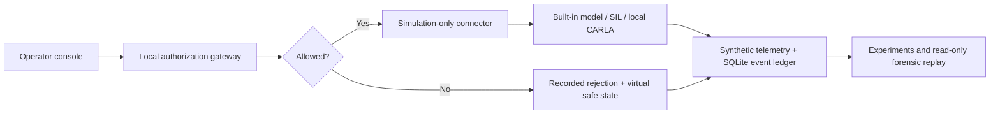

# GHOSTWHEEL <sub>GW-01</sub>

**Take the wheel. Challenge the safeguards. Follow the evidence.**

> A hands-on automotive cybersecurity lab where you can drive fictional electric vehicles, inject synthetic control faults, and investigate exactly how a safety boundary responds.
>
> **No real vehicle is connected or controlled.** Every driving command stays inside the built-in simulator or an explicitly connected local CARLA simulation.


[](LICENSE)

**[Try it in your browser](https://ghostwheel-one.vercel.app)** · **[Start with the simulator](#get-behind-the-virtual-wheel)** · **[Explore the research lab](#four-ways-to-explore)** · **[Read the engineering notes](docs/engineering.md)** · **[Present it in five minutes](docs/presentation-guide.md)**

---

## What happens when a car refuses a command?

A steering request arrives. The authorization gateway checks who sent it, whether it is fresh, whether it repeats an old command, and whether the requested motion belongs inside the model's safety envelope.

If it passes, the **virtual** steering system responds. If it fails, the system records *why* and requests a safe state. You can watch the result, reproduce it with a seed, and inspect the recording later.

GHOSTWHEEL turns that sequence into something you can touch rather than just read about. It is built for students, instructors, researchers, and anyone curious about the boundary between software instructions and cyber-physical behavior.

### The questions you can investigate

- **Can a bad command slip through?** Test malformed, stale, repeated, unauthorized, and implausible synthetic requests.
- **What happens when the operator disappears?** Observe a modeled heartbeat lease and watchdog-triggered safe stop.
- **Do different architectures react differently?** Compare three independently simulated steering systems under a common command contract.
- **Can you prove what happened?** Export experimental results and replay recorded states with integrity checks.

The findings describe **this simulation and its finite test scenarios**, not the security or safety of a production vehicle.

## Four ways to explore

| Area | What you can do | What you learn |
| --- | --- | --- |
| **01 · Operations** | Drive a fictional EV with sliders or keyboard controls and watch live telemetry. | How steering demand, actuator lag, and safe stops affect a simulated trajectory. |
| **02 · Research lab** | Run a repeatable, seeded suite of synthetic command and dropout trials. | Which inputs the gateway rejects and how to interpret measured tracking and processing metrics. |
| **03 · Forensic replay** | Load a recorded session, scrub through frames, and inspect verification status. | How a simulation's event trail can be checked and, for built-in runs, recomputed. |
| **04 · System protocol** | Examine the authorization path, modeled vehicles, connector policy, and optional CARLA bridge. | Where the simulation boundary is enforced and what lies outside the threat model. |

### Meet the virtual fleet

| Vehicle | Fictional architecture | Why try it? |
| --- | --- | --- |
| **ASTER** | Single steering actuator | Start with a clear, simple control response. |
| **VECTOR** | Dual modeled steering channels | Explore independent actuator dynamics and disagreement detection. |
| **NOMAD** | Slower steering response and longer wheelbase | See how a different model changes the same experiment. |

These are **original teaching models**, not representations of actual vehicle makes, firmware, or OEM calibrations.

## Get behind the virtual wheel

**Fastest way in: [open GHOSTWHEEL in your browser](https://ghostwheel-one.vercel.app).** Nothing to install. The browser edition runs the same deterministic simulator, gateway, scenarios and experiment suite as the desktop app, entirely inside the page.

| | Browser edition | Windows desktop app |
| --- | --- | --- |
| **Install** | None. Open the link | Installer |
| **Simulator, gateway, scenarios, experiments** | Same models and results | Same models and results |
| **Recordings** | Kept in the tab (four most recent runs) until you close it. Export to keep one | Saved to a local SQLite database |
| **Simulation connectors** | Built-in and SIL | Built-in, SIL and optional CARLA 0.9.16 |

**For Windows users:** GHOSTWHEEL is a Tauri desktop app with a React console, bundled local Python backend, and SQLite recording. No programming, CARLA installation, vehicle adapter, or external hardware is required to use the installed **built-in simulation**.

**Where to get it:** A Windows installer is generated by the [Windows build workflow](.github/workflows/windows.yml). If a successful workflow run has a downloadable artifact available to your account, find it under [Actions](../../actions/workflows/windows.yml). Installers are build artifacts, **not files checked into this repository**. You can also [build one from source](#build-the-windows-application).

Once installed:

1. **Launch GHOSTWHEEL.** The first-run **Quick start** guide introduces the interface. Follow the in-workspace **Drive → Challenge → Inspect → Keep** walkthrough, or hide it and explore freely.
2. **Select ASTER, VECTOR, or NOMAD** in **Operations** and arm *simulation controls*.
3. **Drive the test field.** Hold **Accelerate**, **Brake**, or a steering button, or use the shortcuts below. Release a held control to coast or center the steering. Sliders keep their set values. Keep the app window focused.
4. **Try a synthetic fault.** **Test a safeguard** explains the result in plain language, retains the reason code, and links directly to the recording.
5. **Inspect and keep the evidence.** In **Forensic replay**, scrub the reconstructed path, choose 0.5×–4× playback, and read the integrity and session summaries. **Export session/replay** downloads JSON; **Open recording** reopens it later. **Research lab** compares all three architectures with a seeded suite.

| Key | Action |
| --- | --- |
| **W** | Virtual throttle |
| **S** | Virtual brake |
| **A / D** | Steer left / right |
| **Space** | Safe Stop: disarm and brake the virtual vehicle |

**Connection trouble?** The desktop launcher starts its own private, loopback-only backend. If you see **SIMULATION OFFLINE**, use **Reconnect** or **Retry** in Quick start. When running from source, confirm that the Python server is listening at `127.0.0.1:8765`.

**Reopening evidence:** Exported session JSON files up to 64 MB can be opened in Forensic replay, entirely on your device. Imported files are validated for viewing and labeled **not verified here**: they contain snapshots, not the original event ledger, so an embedded verification flag is never treated as proof. Locally recorded sessions continue to receive hash-chain verification and, for the built-in model, physics recomputation. Experiment reports are a different JSON format and are not replay files.

**A quick glossary:** *Arm* enables controls for the selected simulation. *Gateway* validates a command before virtual actuation. *Safe Stop* disarms controls and requests braking. *Replay* examines a saved run without sending commands.

## Under the hood



**Design choices that matter:**

- **Simulation-only by construction.** The connector registry accepts only transports declared as `simulation`. Physical CAN, OBD, serial, and remote-vehicle actuation are not implemented.
- **Three independent models.** ASTER, VECTOR, and NOMAD maintain separate virtual state behind the same command interface.
- **Deterministic built-in experiments.** A fixed **50 ms simulation step** and explicit seeds make runs reproducible. Interactive runs are capped at **8,000 ticks (400 simulated seconds)** before a reset.
- **Visible failure handling.** Invalid commands request a safe state; an absent accepted heartbeat expires its six-tick lease and triggers the watchdog on the next tick (**350 ms in simulation time**).
- **Inspectable evidence.** SQLite records a chained event ledger. Built-in recordings support deterministic recomputation; SIL and CARLA recordings use chain verification without built-in-physics recomputation.
- **A local-first console.** The packaged application runs its backend on loopback using a fresh launch secret and an ephemeral port. The browser edition runs a TypeScript port of the same simulator inside the page and sends nothing to a server. Neither is a remotely accessible vehicle controller.

For trust boundaries, validation order, APIs, physics assumptions, and threat model details, see the [engineering architecture](docs/engineering.md).

## Run from source

**Requirements:** Node.js (22 for the documented Windows build), Python **3.11+**, and a terminal. The built-in Python simulator has no third-party runtime dependencies. These commands start the browser-development version of the UI and its local backend.

```powershell
git clone https://github.com/topherchris420/ghostwheel.git
cd ghostwheel
npm ci

# Terminal 1: start the local simulator
$env:PYTHONPATH = (Join-Path $PWD 'backend')
python -m ghostwheel.server --port 8765 --db output/dev.sqlite3

# Terminal 2: start the interface
npm run dev
```

Open the local URL shown by Vite (configured for `127.0.0.1:1420`). The two terminals must remain running for browser development.

To work on the browser edition instead, skip the Python server and run `$env:VITE_SIMULATOR = 'browser'; npm run dev`. `npm run build` produces the hosted browser edition by default. Set `VITE_SUPPORT_URL` at build time to show a **Get support** link in the About panel.

**Reproduce the backend checks and seeded research suites:**

```powershell
$env:PYTHONPATH = (Join-Path $PWD 'backend')
python scripts/verify.py
```

This generates local experiment/verification outputs. Check the resulting receipts and assertions before citing any measurements; a reproducible procedure is not a claim of universal fault coverage.

**Check the browser edition against the Python backend:** `npm run verify:browser` compares trajectories, CAN frames, scenario verdicts and experiment totals between the two implementations.

**Check the user workflow:** `npm run verify:workspace` exercises the React console against the browser simulator in a DOM test environment, including delayed-control/Safe Stop ordering, scenario-to-replay navigation, replay restart, import validation, and focus-loss stopping. `npm run format:check` and `npm run build` check formatting, types, and the production bundle. The DOM checks do not substitute for visual review or native Windows testing.

### Build the Windows application

The documented release target is **Windows x64** with Python 3.11 x64, Node 22, Rust stable **MSVC**, the Microsoft C++ Build Tools workload, and Windows SDK.

```powershell
npm ci
python -m pip install -r scripts/build-requirements.txt
npm run desktop:build
```

The desktop build creates a packaged application and an NSIS installer under `output/release/`. Microsoft WebView2 is required; the installer can obtain its bootstrapper if needed. The current release is **unsigned**.

Full prerequisites, packaging behavior, smoke-test commands, and compatibility-build notes: [Windows packaging guide](src-tauri/PACKAGING.md).

## Optional: connect to CARLA

GHOSTWHEEL runs without CARLA. If you already use the [CARLA simulator](https://carla.readthedocs.io/en/0.9.16/start_quickstart/), the **System protocol** area provides an optional connector to a separately running **CARLA 0.9.16** server at `127.0.0.1:2000`.

The connector requires a matching client/server, an empty simulation world, and exclusive tick ownership. Disconnect it explicitly before closing the app so the adapter can destroy its owned actor and restore simulator settings. An abrupt shutdown may leave external CARLA state behind.

**Validation status:** CARLA SDK import and adapter contract tests are documented, but a full driving run against a live CARLA server was **not validated** in the recorded build. The built-in demonstration and its results do not depend on CARLA.

## What the evidence does and does not say

| The project demonstrates | The project does **not** claim |
| --- | --- |
| A locally testable gateway for synthetic commands | Control of a real electric vehicle |
| Rejection decisions and modeled safe-state behavior | Automotive safety certification or OEM-grade limits |
| Seeded simulation experiments with measured outputs | Protection against every attack or physical fault |
| Integrity checks on locally stored recordings | Tamper-proof or independently signed forensic evidence |
| An optional CARLA simulation adapter | A validated real-CARLA end-to-end driving result |

Synthetic CAN frames are educational representations, **not real vehicle traffic or OEM message mappings**. The research draws on public [OVMS](https://docs.openvehicles.com/) and CARLA documentation; it does not reproduce production vehicle firmware or a vehicle actuation protocol. An REA investigation inventoried an official OVMS Android package but did **not** decompile firmware or establish a production vulnerability. See the [source ledger](evidence/source-ledger.json) and [REA evidence scope](evidence/rea-summary.json).

The interface's **RESTRICTED** label is visual design, not a government or official security classification.

## Go deeper

- **[Engineering architecture](docs/engineering.md):** authorization, models, simulation-only connectors, local API, verification, and limits.
- **[Five-minute demonstration](docs/presentation-guide.md):** a classroom-ready walkthrough from driving to replay.
- **[Research foundations](docs/research-foundations.md):** context, citations, and methodological boundaries.
- **[Verification script](scripts/verify.py):** regenerate evidence instead of trusting a static success claim.
- **[Technical report generator](scripts/report.py):** report source; generated PDFs and receipts live in ignored local `output/` directories rather than in the Git repository.
- **[Windows packaging guide](src-tauri/PACKAGING.md):** installer build, runtime isolation, and validation status.

## Why GHOSTWHEEL exists

Automotive security is often taught as a diagram: controller, network, actuator, consequence. GHOSTWHEEL makes that diagram interactive, measurable, and falsifiable without placing a driver, a passenger, or a real vehicle in the experiment.

**Explore the boundary. Record the result. Know exactly what you have proved.**

---

**License:** [MIT](LICENSE) for original GHOSTWHEEL source. Third-party dependencies and reference material retain their respective licenses. Contributions and reproducible findings are welcome through repository issues and pull requests, subject to repository access.
