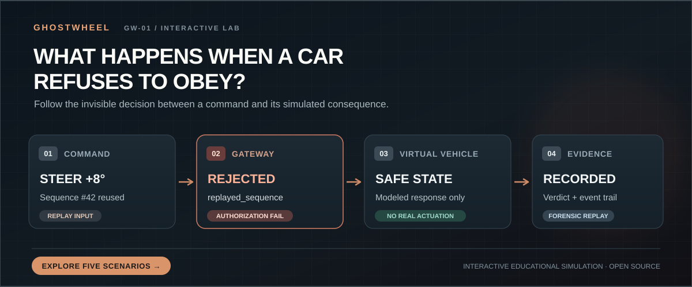
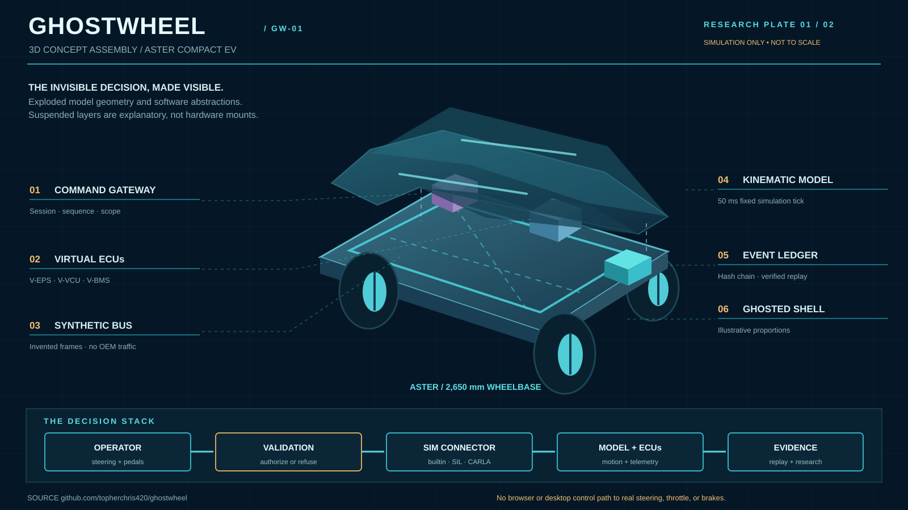

  

<h1 align="center">GHOSTWHEEL GW-01</h1>

<strong>THE COMMAND IS SIMPLE. THE DECISION ISN'T.</strong>

  An interactive automotive cybersecurity laboratory where you can drive a fictional electric vehicle,
  challenge its simulated safeguards, and investigate every decision between a command and its modeled physical response.

  <a href="https://ghostwheel-one.vercel.app"><strong>LAUNCH GHOSTWHEEL ↗</strong></a>
  &nbsp;·&nbsp;
  &nbsp;·&nbsp;
  <a href="https://ghostwheel-one.vercel.app/ghostwheel-decision-lab.html">Interactive diagram</a>
  <a href="#your-first-investigation">First five minutes</a>
  &nbsp;·&nbsp;
  <a href="#inside-the-machine">How it works</a>
  &nbsp;·&nbsp;
  <a href="docs/engineering.md">Engineering notes</a>

Browser-first · No account or installation · No vehicle hardware required

---

> [!IMPORTANT]
> **This is not a real-vehicle controller.** The web and desktop apps cannot steer, accelerate, or brake physical vehicles. A separate, optional ROS 2 package supports **autoware actuation** or **passive, authorized vehicle observation**. Its PACMod3 observer does not issue drive-by-wire commands or perform a physical emergency stop.

## Explore the invisible decision

**What happens when a simulated car refuses to obey?** Try the interactive GHOSTWHEEL decision lab. Choose a command scenario, watch the authorization gateway reach a verdict, and follow its modeled vehicle response into the evidence trail.

  <a href="https://ghostwheel-one.vercel.app/ghostwheel-decision-lab.html"><strong>EXPLORE THE INTERACTIVE DIAGRAM ↗</strong></a>
  &nbsp;·&nbsp;
  <a href="https://ghostwheel-one.vercel.app"><strong>LAUNCH THE FULL SIMULATOR ↗</strong></a>

**Five scenarios:** accepted steering · replayed sequence · conflicting pedals · stale command · expired command lease. Compare the fictional ASTER, VECTOR, and NOMAD vehicle profiles. The diagram is an educational illustration of documented rules, not a live connection to the simulator or a real vehicle.

---

## The interesting part is the refusal

Imagine asking a car to turn right.

The instruction arrives. A gateway inspects who sent it, when it was issued, whether it has already been used, and whether the requested motion fits the model's limits. The command may pass. It may be rejected. Either way, something observable happens next.

**GHOSTWHEEL lets you investigate that moment.**

Instead of showing a green light and asking you to trust it, the laboratory exposes the command verdict, virtual actuator response, synthetic telemetry, recorded events, and evidence you can inspect again. It is a small, deliberately bounded world built to make cyber-physical reasoning visible.

**Discover → Drive → Experiment → Investigate → Understand.**

## Your first investigation

**Five minutes. One virtual vehicle. One question worth answering.**

| Step | Do this | Discover this |
| :--- | :--- | :--- |
| **01 / DISCOVER** | [Launch the lab](https://ghostwheel-one.vercel.app), open **Operations**, and choose **ASTER**. | The vehicle has a modeled architecture, telemetry, and an authorization boundary. |
| **02 / DRIVE** | Select **Enable controls**. Hold **W** to accelerate; steer with **A / D**; use **S** to brake. | Requested steering and modeled steering are not necessarily the same. |
| **03 / EXPERIMENT** | Under **Test a safeguard**, choose **REPLAY / duplicate sequence** and select **Run scenario**. | The gateway rejects a reused command with the reason <code>replayed_sequence</code>. |
| **04 / INVESTIGATE** | Select **Finish drive & review**, inspect integrity, then choose **Save recording** or **Export verification ledger**. | A result is more useful when you can follow its event trail. |
| **05 / UNDERSTAND** | Open **Research lab**, set a seed, and run the experiment suite. | The same test meets three different modeled vehicle architectures. |

**Controls:** Hold **W** to accelerate, **S** to brake, **A / D** to steer, and press **Space** to request a virtual **Safe Stop**. Hold-and-release buttons also work. Keep the app window focused. The in-app **Quick start** and four-step walkthrough guide the same first investigation.

**Operations starts with a focused driving view.** Select **Show technical instruments** for precision sliders, steering response, synthetic CAN messages, ECU health, and command events. Your view preference is remembered on this device. Opening replay stops the driving controls and pauses the live simulation; use **Return to simulator**, then **Resume simulation** to continue. Walkthrough progress belongs to the current run and survives leaving replay.

Nothing in that sequence requires a real car, a CAN adapter, ROS 2, or CARLA.

---

## The fleet

**Three fictional electric vehicles. Three ways for a command to become motion.**

| Vehicle | Teaching architecture | What makes it interesting |
| :--- | :--- | :--- |
| **ASTER / compact EV** | A central gateway and one modeled steering ECU; **2.65 m** wheelbase. | Start here. Explore basic steering lag, validation, and virtual safe-state behavior. |
| **VECTOR / touring EV** | Two steering channels with slightly different response rates; **2.96 m** wheelbase. | Examine channel disagreement and a modeled monitor that reacts beyond a **2°** difference. |
| **NOMAD / utility EV** | A zonal teaching profile and slower steering actuator; **3.25 m** wheelbase. | See why an identical instruction can trace a different path through a longer, slower model. |

Change vehicles. Repeat a test. Compare the response.

These are **original, simplified models** with invented parameters, virtual ECU names, and synthetic CAN frames. They are not digital twins of commercial vehicles, validated OEM calibrations, or firmware emulators. The point is to understand *how assumptions change outcomes*, not to rank real cars by security.

## GW-01 concept blueprint

**The invisible decision, made visible.** Explore a high-level CAD-style
interpretation of ASTER's virtual chassis, command gateway, synthetic
telemetry, software ECUs, and recorded evidence.

**Explore the assembly:** [Editable 3D OpenSCAD model](docs/cad/gw01-aster.scad)
· [Full blueprint notes](docs/cad/README.md)
· [Engineering architecture](docs/engineering.md)

This is a **conceptual research illustration**, not a physical vehicle
controller or build-ready automotive CAD model. ASTER's **2.65 m wheelbase**
comes from the simulator; the rest of the geometry is illustrative.
No browser or desktop control path reaches real steering, throttle, or
brakes.

## The gateway

**Every request has to earn its way to a simulated actuator.**

Before a control reaches the model, GHOSTWHEEL checks its structure, session and capability, vehicle scope, sequence number, simulation timestamp, value ranges, conflicting pedals, steering slew, and a simplified lateral-acceleration envelope.

Consider two requests:

| Request | Gateway decision | Modeled consequence |
| :--- | :--- | :--- |
| A fresh, authorized steering request inside the model's limits | <code>authorized</code> | The virtual actuator begins responding, with its own lag and rate limit. |
| Throttle **0.8** and brake **0.8** in one command | <code>conflicting_pedals</code> | The command is rejected, a virtual safe state is requested, and the event is recorded. |

A repeated sequence produces <code>replayed_sequence</code>. An old simulation timestamp produces <code>stale_command</code>. The fault explorer also covers invalid credentials, future timestamps, out-of-range demands, implausible steering jumps, malformed envelopes, and dropped heartbeats.

The built-in world advances in **50 ms simulation steps**. Its six-tick command lease triggers a modeled watchdog stop on the seventh tick, **350 ms of simulated time** after the last accepted control tick. This is **not** a wall-clock guarantee, physical stopping distance, or safety-rated intervention.

The connector registry enforces another boundary: **application actuation transports must be simulation-only**. Physical CAN, OBD, serial, and remote-device actuation connectors are rejected by design. See [the implementation](backend/ghostwheel/connectors.py) and [the trust model](docs/engineering.md).

## The laboratory

**Don't just trigger a fault. Make it measurable.**

The **Research lab** runs a seeded experiment suite across ASTER, VECTOR, and NOMAD. Each architecture has a baseline trajectory, eight finite invalid-command trials, and a separate missing-heartbeat trial.

You can inspect:

- **Gateway verdicts:** what was accepted or rejected, and why.
- **Steering tracking RMSE:** how the modeled actuator followed the requested angle.
- **Gateway processing time:** local software validation and state-application timing, not network latency or real actuator timing.
- **Watchdog outcomes and assertions:** what the finite scenarios actually checked, including failures.
- **Exported report JSON:** the seed, per-architecture results, and measured totals.

Try **seed 42**, then run another seed. Compare ASTER with VECTOR. Ask whether a different steering response changed the experiment's conclusion.

The suite is repeatable; it is not an exhaustive attack test. Measurements describe this implementation and its synthetic models, not real-world vehicle safety or an OEM vulnerability.

## The evidence

**A simulation is an experience. A recorded decision is something you can investigate.**

In **Forensic replay**, select a locally recorded session to play, pause, scrub, and examine its frames. GHOSTWHEEL checks the local event hash chain and recorded summaries. Runs from the **built-in** connector can also be checked by deterministic physics recomputation.

There are two deliberately different exports:

| Export | What it gives you | Important limit |
| :--- | :--- | :--- |
| **Save recording** | A JSON snapshot you can reopen for view-only playback. | Imported snapshots are marked **not verified here**; they do not carry the original event ledger. |
| **Export verification ledger** | The full event ledger for standalone structural and hash-chain verification. | A hash chain is not proof of independent provenance if someone can rewrite both the ledger and its saved head. |

Export important browser sessions. The browser retains recent runs in memory and attempts best-effort persistence with IndexedDB, but storage may be evicted or cleared. The Windows edition records to a local SQLite ledger.

Verify an exported evidence bundle with:

~~~sh
python scripts/verify-evidence.py evidence.json
~~~

For stronger provenance, compare against an independently retained terminal hash or an investigator-managed Ed25519 signature. See [portable evidence verification](docs/evidence-verification.md). The verifier checks the ledger; it **does not** independently rerun the underlying physics.

---

## Inside the machine

**One rule governs the system: application control ends at the simulation boundary.**

~~~mermaid
flowchart TB
  subgraph APP["GHOSTWHEEL · browser or desktop"]
    UI["Operator console"] --> GW["Command authorization gateway"]
    GW -->|"accepted"| ROUTE{"Simulation-only connector"}
    GW -->|"rejected"| SAFE["Reason + modeled safe state"]
    ROUTE --> BUILTIN["Built-in vehicle model"]
    ROUTE --> SIL["In-process SIL transport"]
    ROUTE -.-> CARLA["Optional local CARLA 0.9.16"]
    BUILTIN --> LEDGER["Recorded events + synthetic telemetry"]
    SIL --> LEDGER
    CARLA --> LEDGER
    SAFE --> LEDGER
    LEDGER --> LAB["Research metrics"]
    LEDGER --> REPLAY["Read-only forensic replay"]
  end

  subgraph ROS["Separate optional ROS 2 processes"]
    AUTOWARE["Autoware command topic"] --> SIMHAL["Synthetic HAL + simulated reports"]
    REPORTS["Authorized CAN, serial, or PACMod3 reports"] --> OBS["Passive observation"]
    OBS --> ADVISORY["Diagnostics + advisory status"]
  end
~~~

*The lower ROS 2 processes are separate from the browser/desktop actuation path. No arrow from the application reaches a physical actuator.*

### Choose your simulation environment

| Environment | Available where | What it actually does |
| :--- | :--- | :--- |
| **Built-in** | Browser and Windows | Original fixed-step vehicle physics; recorded runs support chain verification **and** deterministic recomputation. |
| **SIL** | Browser and Windows | A modeled in-process software-in-the-loop transport; the built-in model still owns physics. Replay checks the chain, not independent physics recomputation. |
| **CARLA bridge** | Optional Windows/local Python setup | Connects to a separately running **local CARLA 0.9.16 simulator**. Requires a compatible client/server and an appropriate empty simulation world. |

**CARLA status:** the adapter has code and contract-level checks, but a live end-to-end CARLA driving session was **not validated** in the recorded build. Its recorded sessions are chain-verified rather than deterministically recomputed. CARLA is not required for the first-run experience.

### Two editions, one simulation boundary

| | **Browser** | **Windows x64 desktop** |
| :--- | :--- | :--- |
| Start | [Open the hosted experience](https://ghostwheel-one.vercel.app) | Build locally or retrieve a workflow artifact |
| Simulator | Local in-page TypeScript implementation | Local Python backend with Tauri shell |
| Built-in and SIL experiments | Yes | Yes |
| CARLA bridge | No | Optional local connection |
| Session history | Recent runs; best-effort IndexedDB storage | Local SQLite |
| Real-vehicle actuation | **Never** | **Never** |

The browser executes simulation logic locally rather than sending your driving inputs to a hosted application backend. The desktop app starts a loopback-only sidecar with a per-launch secret. Neither edition needs a vehicle interface.

### ROS 2 is a separate interface, not a hidden driving mode

The optional C++17 [ROS 2 / Autoware package](ros2/ghostwheel_vehicle_interface/README.md) supports ROS 2 Humble or Iron on Linux, with an existing sourced Autoware workspace.

- **<code>sim</code>:** consumes Autoware actuation requests and publishes **synthetic** actuation and velocity reports. Its default **100 ms** command timeout stops only the simulated HAL.
- **<code>can</code>, <code>obd</code>, <code>serial</code>:** receive authorized observations only. Incoming Autoware actuation is ignored; raw CAN frames/serial bytes are not silently interpreted as calibrated vehicle feedback.
- **PACMod3 observer:** an optional, separate subscriber to existing kit reports. It may publish observed status and conditional, calibrated feedback; default conversions remain disabled or unconfirmed. Its <code>stop_requested</code> output is **software advice**, not physical braking, drive-by-wire engagement, or an emergency-stop circuit.

These paths are for simulation and **authorized passive diagnostics**. The PACMod3 observer never publishes physical actuator commands. Follow the [ROS 2 setup and safety notes](ros2/ghostwheel_vehicle_interface/README.md) before attaching diagnostic hardware.

---

## Run GHOSTWHEEL yourself

### 1. Browser-only development

Requires **Node.js 22**, Git, and npm. No Python service or CARLA installation is necessary for the in-page simulator.

~~~sh
git clone https://github.com/topherchris420/ghostwheel.git
cd ghostwheel
npm ci
VITE_SIMULATOR=browser npm run dev
~~~

Open **http://127.0.0.1:1420**.

On Windows PowerShell, replace the last command with:

~~~powershell
$env:VITE_SIMULATOR = 'browser'
npm run dev
~~~

Build the production browser bundle with <code>npm run build</code>. The web deployment configuration is in [vercel.json](vercel.json).

### 2. Local Python service + web console

Requires **Python 3.11+** in addition to Node.js 22. The built-in Python simulator has no third-party runtime dependencies. After cloning and running <code>npm ci</code>, use two terminals from the repository root.

**Terminal 1 · Python backend (PowerShell)**

~~~powershell
$env:PYTHONPATH = (Join-Path $PWD 'backend')
python -m ghostwheel.server --port 8765 --db output/dev.sqlite3
~~~

**Terminal 2 · development console**

~~~powershell
npm run dev
~~~

The development UI is served at **http://127.0.0.1:1420** and connects to the local service at **127.0.0.1:8765**. On Linux/macOS, set <code>PYTHONPATH=backend</code> for the Python command.

### 3. Windows desktop build

Requires Windows x64, **Python 3.11 x64**, **Node.js 22**, **Rust stable MSVC**, Microsoft C++ Build Tools, and the Windows SDK.

~~~powershell
npm ci
python -m pip install -r scripts/build-requirements.txt
npm run desktop:build
~~~

The NSIS installer and receipts are written under <code>output/release/</code>. Microsoft WebView2 is required. The installer is **unsigned**, not a certified automotive tool, and not committed to the repository. When available, build artifacts appear in the [Windows Actions workflow](.github/workflows/windows.yml). Read the [packaging guide](src-tauri/PACKAGING.md) for installer and native smoke-test details.

## Release quality and responsible distribution

GHOSTWHEEL is an experimental simulator. A Vercel preview or a successfully
uploaded installer is **not** proof of reliability, release approval, or vehicle
safety. Use [the release checklist](docs/release-checklist.md) before sharing a
binary or changing repository visibility.

The release process now includes an offline, fail-closed preflight:

~~~sh
python scripts/release_gate.py
~~~

It checks that npm/Tauri versions agree, required security and contribution
policies exist, and the Windows installer remains a per-user NSIS package.
The Windows release-candidate workflow additionally exercises the packaged
backend, portable native UI, silent installer, installed UI, and final QA
receipts. **Only after all these succeed** does it attempt to upload an
unsigned candidate. Its final gate verifies portable ZIP contents,
SHA-256 hashes, the build receipt, and QA evidence:

~~~powershell
python scripts/release_gate.py --artifacts
~~~

If GitHub Actions has not allocated a runner or no test steps executed, CI
is **blocked, not passing**. Public source and signed binaries require
separate explicit approval. See [CONTRIBUTING.md](CONTRIBUTING.md),
[SECURITY.md](SECURITY.md), and [CHANGELOG.md](CHANGELOG.md).

## Verify, don't take our word for it

Run the repository's browser parity, workspace, build, and backend checks:

~~~sh
npm ci
npm run format:check
npm run verify:browser
npm run verify:workspace
npm run build
PYTHONPATH=backend python scripts/verify.py
PYTHONPATH=backend python -m unittest discover -s tests -v
~~~

On Windows PowerShell, set <code>$env:PYTHONPATH = (Join-Path $PWD 'backend')</code> before the Python commands.

The browser parity suite compares seeded trajectories, synthetic frames, scenario verdicts, and experiment results against the Python model. Workspace checks exercise selected UI behavior in a DOM environment, **not** a native Windows usability certification. Consult the generated output before quoting performance or research results.

### What the laboratory does not prove

GHOSTWHEEL deliberately does **not** model tire forces, slip, collisions, detailed road conditions, real CAN electrical behavior, production ECU firmware, or OEM-calibrated controls. Synthetic frames are not captured vehicle traffic. A modeled safe stop is not a guaranteed real stopping maneuver. The app is not a hard real-time controller, physical penetration-testing device, safety-certified vehicle controller, or substitute for independent vehicle protections.

The research ledger documents public OVMS/CARLA references and a limited REA inventory of an official OVMS Android artifact. It does **not** claim firmware decompilation or a production exploit. The interface's **RESTRICTED** motif is fictional, not an official classification.

Read the [research foundations](docs/research-foundations.md), [source ledger](evidence/source-ledger.json), and [REA scope](evidence/rea-summary.json) for provenance and boundaries.

---

## Make the next investigation better

GHOSTWHEEL is useful when a question can be turned into a reproducible experiment.

If you have repository access, bring a **seed, vehicle profile, scenario, observed verdict, expected behavior, and evidence** to an issue or pull request. Particularly useful contributions include new *synthetic* fault cases, sharper explanations, better accessibility, replay verification, and independently validated simulator integrations. Keep physical actuator control outside the application boundary.

**Start with the evidence. Improve the model. Make the reasoning clearer.**

**Further reading:** [Five-minute classroom demo](docs/presentation-guide.md) · [Engineering architecture](docs/engineering.md) · [Evidence verification](docs/evidence-verification.md) · [ROS 2 / PACMod3 observer](ros2/ghostwheel_vehicle_interface/README.md) · [Windows packaging](src-tauri/PACKAGING.md)

Original GHOSTWHEEL source is released under the [MIT License](LICENSE). Third-party dependencies and reference snapshots retain their respective licenses.

<strong>DRIVE THE SIMULATION. QUESTION THE DECISION. KEEP THE EVIDENCE.</strong>

