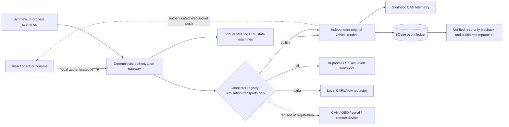

# Engineering architecture

## Trust and data flow

Tauri owns the child Python process, selects a fresh launch secret and gets the assigned loopback port through the private ready pipe. The frontend receives connection details through one narrow Tauri command. In packaged desktop mode, all data endpoints require the launch secret. Health contains no secret. Browser development uses fixed port 8765 and locally bootstrapped credentials.

Live state reaches the UI over a WebSocket at `/api/stream`. It is a dependency-free RFC 6455 implementation in `server.py`, so the frozen sidecar still has no third-party runtime packages. Browsers apply no CORS to WebSockets and cannot attach `X-Ghostwheel-Token` to the handshake. The stream therefore goes through the same Host and Origin allowlist as every other route, which is what stops another web page from opening it. The client's first message must be `{"type":"auth","token":...}`, compared in constant time. Without it the server closes with 1008 and sends nothing. Client frames must be masked and unfragmented, and are capped at 1 KiB. The Tauri CSP allows `ws://127.0.0.1:*` alongside the existing loopback HTTP origin.

All server mutations require `X-Ghostwheel-Token`. HTTP checks exact Host and an explicit origin list; response CORS never uses a wildcard. Strict JSON rejects duplicate keys, nonfinite numeric exponents, invalid media types and bodies above 8 KiB. No physical transport module is imported. [Implementation: `src-tauri/src/main.rs`, `backend/ghostwheel/server.py`; evidence: HTTP boundary tests in `tests/test_system.py`.]

## Common contract and models

`World` owns three `VirtualVehicle` instances with separate kinematics, pseudo-random generators, controllers, counters and control leases. The chosen vehicle is the console focus. A common command contract uses normalized steering, throttle and brake, a monotonically increasing sequence, an issued simulation tick, a session identifier and a capability. Reset changes session identity, so commands from a previous run are rejected.

ASTER has one steering actuator model. VECTOR has two independent first-order steering ECU channels with slightly different time constants, and a latched 2-degree disagreement threshold. NOMAD has a slower actuator and longer wheelbase. These numbers are invented teaching parameters. There is no OEM calibration or production-security ranking. Other ECU labels represent telemetry producers/consumers around aggregate vehicle state; they are not firmware or instruction-set emulation. [Implementation: `model.py`, `ecu.py`, `engine.py`; validation: independent-state and disagreement tests.]

The shared ground-plane convention follows CARLA: x forward, y right, positive yaw clockwise viewed from above, and positive steering to the right. The console projection preserves this handedness. [CARLA coordinates](https://carla.readthedocs.io/en/latest/coordinates/).

The builtin dynamics use a kinematic bicycle relation: yaw rate is speed divided by wheelbase times tangent of modeled steering angle after conversion from degrees to radians. Each steering channel is a first-order lag with a rate bound. Longitudinal acceleration combines configured throttle acceleration, brake deceleration and a simple drag term. A seeded tiny steering disturbance affects path integration. The model omits tire force, slip, suspension, collisions, road geometry, thermal battery behavior and functional safety certification.

## Gateway and safe states

Validation order is schema, session, capability, vehicle scope, integer sequence, timestamp type, future/expired timestamp, replay sequence, numeric finiteness/ranges, pedal conflict, steering demand slew, and lateral acceleration envelope. The last model check uses `v^2 * abs(tan(delta_deg * pi / 180)) / wheelbase <= 5 m/s^2`. This is a teaching envelope, not an OEM limit.

Steering slew is budgeted against a per-tick anchor so same-tick command bursts cannot accumulate multiple movement allowances. The actuator itself independently rate-limits its response. An accepted command updates only its intended virtual vehicle. Rejection places a recognized target into the safe state; an unroutable authenticated envelope stops all virtual vehicles. The safe state requests neutral steering, zero throttle and brake 0.35, while actual modeled steering remains rate limited. The explicit operator stop uses brake 0.7 and disarms the heartbeat.

An authenticated malformed HTTP control body is normalized to a rejected empty envelope, recorded and safe-stopped. A rejected unauthenticated transport request is never applied; an existing authorized lease expires on the normal watchdog. Inactivity exceeds the six-tick lease on tick seven, 350 ms after the last accepted tick. This is simulation time; a stalled operating system cannot provide hard real-time guarantees.

A recording or uncaught simulation failure pauses the world and zeroes all model demands. A CARLA adapter failure safe-stops the selected model and pauses the world. Fatal recording and CARLA adapter failures are latched: reset is required before control/resume. SQLite errors may make a partial run unverifiable; the application never repairs evidence silently. [Implementation: gateway, engine, server; validation: malformed values, burst, lease, disk-full and HTTP tests.]

## Actuation connectors

A connector is the transport between the authorization gateway and whatever consumes authorized actuation. `connectors.py` turns the simulator-only rule into enforced code. Each connector has a frozen `ConnectorDescriptor` with an `id`, a `transport`, a `recompute` flag and optional module prerequisites. `register()` raises `UnsafeConnectorError` for any transport other than `"simulation"`, so a CAN, OBD, serial or remote-device connector never enters the registry and cannot be listed, selected or reached through the API. `create()` checks a second time: if a factory returns a connector whose descriptor states a different transport, `create()` closes it and raises. [Validation: registry refusal, factory-smuggling and catalog tests.]

| Connector | Transport | Replay | Behavior |
| --- | --- | --- | --- |
| `builtin` | simulation | recomputed | The original fixed-step model owns physics. Default for every run. |
| `sil` | simulation | chain-verified | Software-in-the-loop. Authorized actuation is serialized through a modeled in-process transport with seeded, bounded latency (0.8–1.2 ms) and a frame counter. The returned observation is the model's own state, so the trajectory and the state digest equal a builtin run. It measures the transport layer and adds no physics. |
| `carla` | simulation | chain-verified | Optional bridge to a local CARLA 0.9.16 server on `127.0.0.1:2000`. Requires the `carla` module. Unchanged adapter contract. |

Connectors follow the engine's existing adapter contract (`apply_and_tick`, `close`, `metadata`, `last_observation`), so the fixed-step loop did not change. `World.attach_connector()` sets the connector id and mode. `Application.attach()` creates the connector before it replaces the running world, so a failed connection leaves the current session as it was. Each connector switch starts a separate recording, and the run metadata stores the connector's metadata. A failure in a non-builtin connector safe-stops the vehicle, pauses the world and latches `connector_failure_reset_required`; for CARLA the latch is `carla_adapter_failure_reset_required`. Only a run made with the builtin connector is recomputed on replay. The others report `recomputed: false` and are verified by the hash chain alone.

## Virtual CAN representation

Telemetry objects carry an invented extended 29-bit identifier, eight synthetic bytes, tick, bus label and ECU name. Values encode modeled angle, speed, state of charge, heartbeat counters and safe-state flags. They never leave Python via a vehicle transport. The display marks every frame synthetic.

The current virtual CAN layer is a logical message generator. It does not simulate bitwise arbitration, CRC, bit stuffing, ACK, error counters, retransmission, bus-off recovery, bus bandwidth, multibus routing or electrical behavior. Bus topology labels distinguish the teaching profiles; only the first configured bus carries generated frames. ECU rx/tx counters are illustrative broadcast counters. These limits prevent claims of validated zonal networking or wire-level CAN behavior. [Implementation: `VirtualVehicle._synthetic_frames`; protocol context: source ledger CIA-CAN.]

## Recording and replay

SQLite WAL stores run metadata and a per-run ordered event ledger. Events include initialization, sanitized input plus decision, physics frames, stop and pause. Each event hashes the previous hash plus its canonical ordinal, kind, tick and payload. The index stores the terminal digest and count. Run identity, kind, timestamp, seed and architecture are chained. The replay verifier checks event continuity, chain digests, frame digests, metadata, frame count and summary equality.

Builtin replay also creates a fresh World, restores the seed/session scope, substitutes a replay-only credential for a recorded validity marker, reapplies recorded inputs and compares every deterministic state digest. Actual capability secrets are not persisted. Host timing metrics are excluded from deterministic state equality because scheduling varies. Interactive forensic playback displays the verified saved frames and never issues actuation commands.

CARLA recording supports chain-verified playback only. It does not claim builtin-model recomputation or invoke CARLA's own recorder. All local digests could be rewritten by a host administrator with database access; use an independently stored/signed terminal digest if evidence provenance is required. [Implementation: `recorder.py`; validation: payload/deletion/metadata/summary tampering and full recomputation tests.]

## Timing and experiment metrics

The simulation advances fixed `dt=0.05 s` steps. The interactive host attempts one step every 50 ms, drops wall-clock catch-up rather than expanding physics dt, and is not a real-time controller. The server pushes a snapshot on every tick (20 Hz) and after every accepted mutation, so the UI sees each tick rather than sampling every other one. A one-second re-check catches any change that was not published, and identical snapshots are not re-sent. The UI still sends controls over `POST /api/control` around 10 Hz, keeping the strict JSON validation and recording path. If the stream is unavailable, the UI falls back to polling `/api/state` at 10 Hz and reconnects with backoff up to 5 s; the top bar shows PUSH or POLL. The command lease is based on simulation ticks.

`gateway_ms` is elapsed `perf_counter_ns` wall time surrounding validation and state application. It excludes HTTP transport, SQLite recording, rendering and physical response. P95 uses sorted observed samples with index `min(n-1, floor(0.95*n))`. Tracking RMSE is `sqrt(mean((target_angle-model_angle)^2))` sampled every physics tick.

Each baseline is 160 ticks / 8 simulated seconds, with 80 valid commands and a 0.18-amplitude 1.2-rad/s sinusoidal normalized steering demand. Each architecture has eight invalid-command trials and one missing-heartbeat trial. Report rejected-command rate only over the eight injected invalid commands; missing heartbeat is a separate timeout outcome. Three seeds exercise deterministic repetition, not a statistical claim of exhaustive attack coverage. [Protocol implementation: `experiments.py`; machine output: `output/experiments/seed-*/results.json`.]

## Local API

| Method and route | Behavior |
| --- | --- |
| GET `/api/health` | App/version, simulation-only flag, degraded-state reason |
| GET `/api/bootstrap` | Session, credential, profiles, finite scenario inventory, current snapshot |
| GET `/api/state` | Current state, metrics, virtual ECU/frame/event streams |
| GET `/api/stream` | WebSocket upgrade; first message authenticates, then `{"type":"snapshot"}` pushes on every change |
| POST `/api/control` | Typed simulator-only control, explicit accepted/reason decision |
| POST `/api/reset` | Seed/profile validation, fresh session and recording |
| POST `/api/stop` | Explicit simulator safe stop |
| POST `/api/pause` | Pause/resume; fatal conditions require reset |
| POST `/api/scenario` | Execute one finite in-process synthetic trial |
| POST `/api/experiments` | Isolated deterministic suite, stored in experiment SQLite/JSON |
| GET `/api/runs` | Recent interactive recordings (index listing is a navigation view) |
| GET `/api/replay?id=...` | Verify chain and return saved frames/recomputation results |
| GET `/api/connectors` | Connector catalog, prerequisite availability, active connector, transport policy |
| POST `/api/connector/connect` | Route actuation through a registered simulation connector (`connector_id`); fresh run |
| POST `/api/connector/disconnect` | Release the active connector; fresh builtin run |
| GET `/api/carla/status` | SDK availability and whether the active connector is CARLA |
| POST `/api/carla/connect` | Explicit matching local CARLA server, empty-world prerequisite |
| POST `/api/carla/disconnect` | Destroy owned actor, restore settings, fresh builtin run |

No endpoint accepts a vehicle network address, OEM CAN write, arbitrary simulator host, shell command or arbitrary file path. The connector registry rejects any non-simulation transport at registration, so no such connector can be named in a request. CARLA blueprints are allowlisted simulation assets. Secrets remain local; TLS is not used on loopback. The host and installed binary are trusted. This is not a defense against a compromised local administrator.

## Browser edition

The hosted web build runs the simulator inside the page, so it needs no backend, install or network access after load. `src/api.ts` picks the edition: the Tauri app uses its bundled loopback service, `npm run dev` uses a Python server on port 8765, and a production web build uses `src/sim/`. `VITE_SIMULATOR=browser|local` overrides the web default. The browser simulator is a separate chunk that the desktop app never loads.

`src/sim/` is a line-for-line TypeScript port of `model.py`, `ecu.py`, `gateway.py`, `engine.py`, `experiments.py`, `recorder.py` and the SIL connector, behind an in-process service (`backend.ts`) that answers the same routes as the table above and pushes the same snapshots the WebSocket stream does. Request bodies make a JSON round trip, so value semantics match the HTTP boundary. `random.ts` reproduces CPython's seeded Mersenne Twister, so a seed drives the same actuator disturbance in both editions.

`npm run verify:browser` (also run in CI) bundles the port and checks it against the Python backend: SHA-256 against Node, `random.Random` bit for bit, every architecture's trajectory, CAN frames and ECU counters over several seeds (states agree to about 1e-15), all 27 scenario verdicts, and the experiment suite's assertion totals. It also confirms that an edited recording is rejected and that a full 8,000-tick run recomputes on replay.

Differences from the desktop app:

- Recordings stay in memory and are cleared when the tab closes. Only the four most recent interactive runs are kept, because a full-length run holds about 50 MB. Exported JSON is the way to keep one.
- CARLA is unavailable. The SIL connector works.
- Gateway latency uses `performance.now()`, which browsers coarsen. `vercel.json` sets COOP/COEP so the page is cross-origin isolated, which gives the finer browser timer, and the experiment report notes the quantization.
- Long replays and the experiment suite yield to the page every 12 ms, so the console stays responsive while they verify.

## Acceptance evidence and limits

The final verification receipt names the tested backend/test source hashes and host. The exact Python-run receipt is preserved as `python-test-run.json`; final frontend identities and its separately scoped QA receipts are retained alongside it. `source-manifest.json` identifies the final original source and configuration. The source tests cover validation boundary conditions, forward/repeated sequence rejection, three independent vehicles, finite numeric handling, per-tick slew limits, ECU disagreement, watchdog state, HTTP origins/Host/authentication, record corruption, recording-failure latch, a mocked CARLA SDK contract, and the connector boundary: refusal of non-simulation transports, factory-smuggling defence, SIL determinism and digest parity with builtin, chain-verified SIL replay, connector failure latching and the connector HTTP surface. Stream tests use a raw-socket client and cover the RFC 6455 accept key, foreign-Origin refusal, close 1008 with no snapshot for a wrong token, a push after each control and stop, the echoed close, and a 1001 close on shutdown. The Windows build receipt and UI QA evidence document separate packaging and interaction checks.

The desktop process-tree cleanup does not guarantee external CARLA actor/settings cleanup after abrupt exit. Explicitly disconnect before closing; reset the external simulator if a crash leaves an actor. This is a design limitation awaiting running-server lifecycle validation.

Full CARLA physics, hardware fixtures, production EV interfaces, wire-level CAN behavior, formal verification, penetration testing of OVMS/CARLA and automotive certification are outside the validated scope. The report distinguishes these unknowns from passing local-model experiments.

## Optional ROS 2 connector and hardware monitoring (GW-01)

A standalone C++17 ROS 2 package now lives at `ros2/ghostwheel_vehicle_interface/` with a synthetic Autoware HAL and passive CAN, OBD serial, and custom serial monitors. This does **not** change `backend/ghostwheel/connectors.py`, whose registry continues to reject physical actuation transports. The UI's System protocol page exposes setup instructions for the two distinct workflows.

The ROS simulation node subscribes to Autoware actuation commands and publishes synthetic actuation/velocity reports, a heartbeat, and state/fault diagnostics. Default timeout is 100 ms of monotonic time and applies a **virtual** brake. Physical observation modes do not transmit actuation commands or publish invented actuator/speed measurements; they currently count received frames/bytes without OEM signal decoding. No browser-to-ROS physical control path exists. ROS shutdown is not a hardware safety guarantee.

## PACMod3 read-only observer

An optional ROS 2 `ghostwheel_pacmod3_adapter` executable subscribes to
PACMod3 global, subsystem, speed, yaw and emergency-stop report topics and
observes Autoware Control messages without forwarding them to hardware. It
publishes a conservatively inferred Autoware ControlModeReport, fault and
advisory software stop-request topics. The pure C++ observer state machine
can be tested without ROS. PACMod3 feedback is published to Autoware only
after explicit platform-specific conversion settings are configured.
The driver owns the physical CAN connection and safety control.
This observer makes no claims of physical emergency stop, drive-by-wire
engagement authority or hardware functional safety certification.
